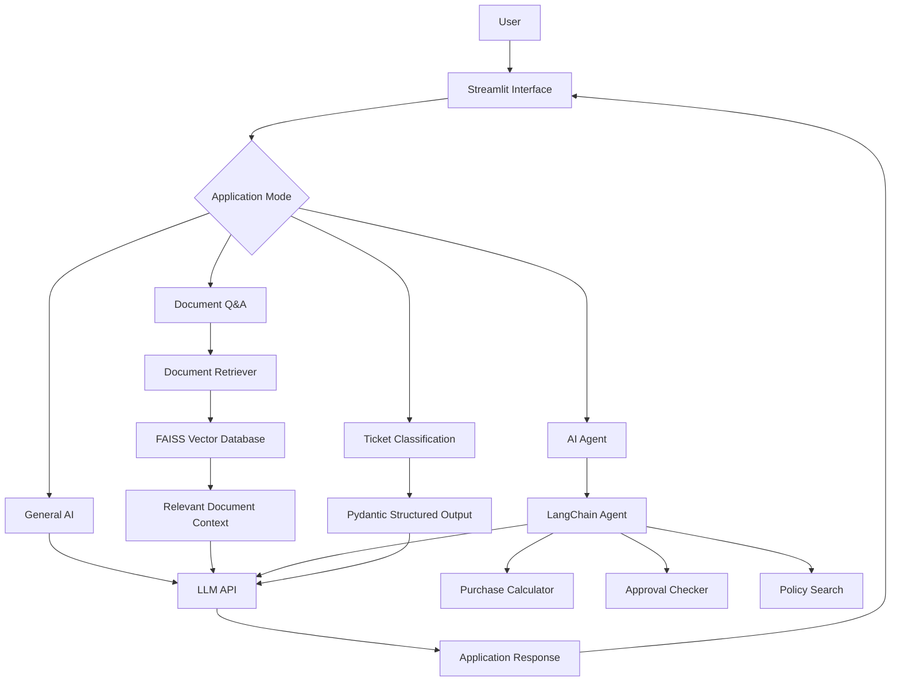
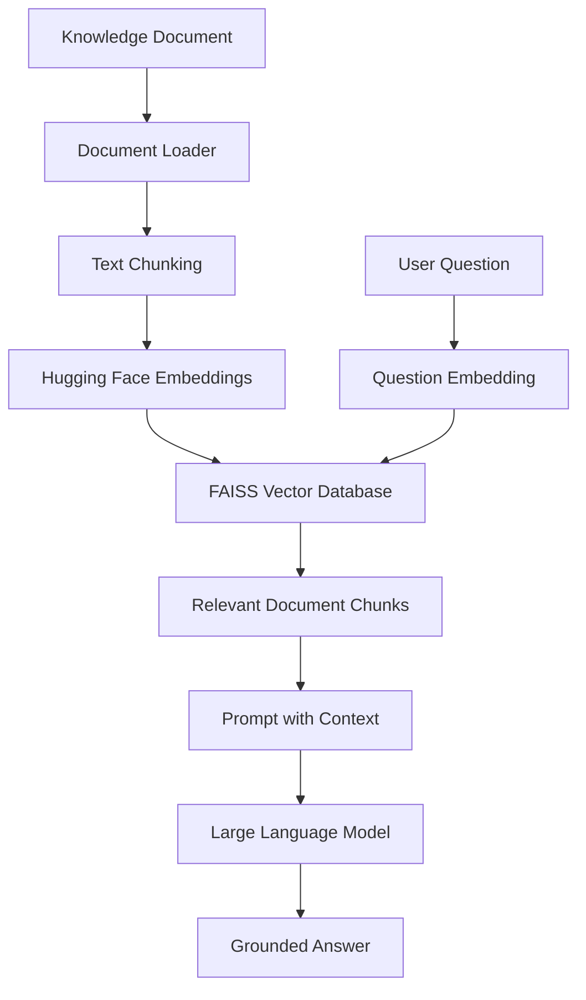
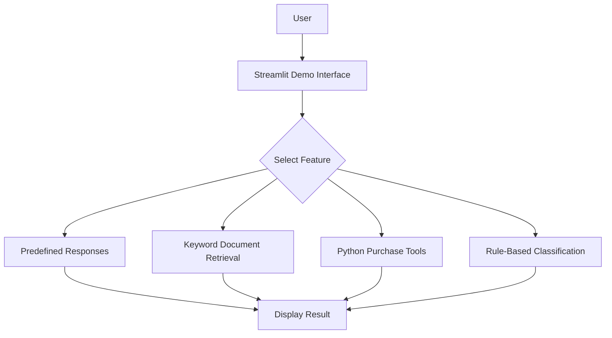
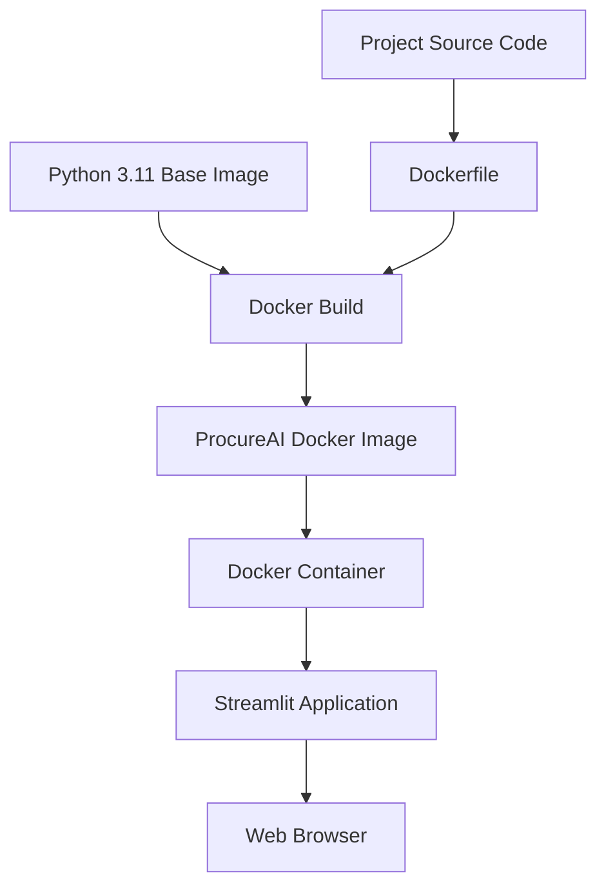
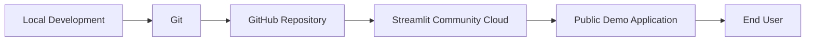

# 🤖 ProcureAI — Intelligent Procurement Knowledge Assistant


## 📌 Project Overview

ProcureAI is an intelligent procurement knowledge assistant designed to demonstrate how Generative AI can improve enterprise procurement, document retrieval, purchase management and support ticket classification.

The application combines Large Language Models (LLMs), Retrieval-Augmented Generation (RAG), vector databases, AI agents, tool calling and structured outputs within an interactive Streamlit interface.

The project provides two versions:

- **Full AI Application:** Uses live LLM integration, semantic document retrieval and AI agents.
- **API-Free Demo:** Demonstrates selected business workflows using local Python logic without requiring API credentials or paid LLM credits.

## 🌐 Live Demo

Live application: Coming soon — Streamlit Community Cloud deployment.

The public demo does not require an API key.

## 🎯 Project Objectives

- Simplify access to company procurement policies.
- Retrieve relevant information from company documents.
- Demonstrate practical Generative AI applications.
- Calculate purchase costs and check approval requirements.
- Classify enterprise support tickets.
- Reduce repetitive manual information searches.
- Demonstrate AI application containerization and deployment.

## ✨ Key Features

### 1. General AI Assistant

- Interactive chatbot interface.
- LLM-powered responses in the full application.
- Conversation history and context management.
- Prompt engineering.
- Predefined responses in Demo Mode.

### 2. Document Question Answering

- Retrieval-Augmented Generation (RAG).
- Document loading and text chunking.
- Hugging Face sentence embeddings.
- FAISS vector database.
- Semantic similarity search.
- Retrieved document evidence.
- Context-based answer generation.
- Instructions to avoid unsupported answers.

### 3. AI Agent and Tool Calling

The full application uses LangChain agents to select and execute relevant tools.

Available tools:

- Purchase cost calculator.
- Purchase approval checker.
- Company policy retrieval.

Example:

```text
Price per laptop: ₹40,000
Quantity: 20

Total purchase cost: ₹8,00,000
Approval status: Manager approval required
```

### 4. Support Ticket Classification

Classifies enterprise support tickets into relevant categories.

Example input:

```text
The supplier submitted an incorrect invoice.
```

Example structured output:

```json
{
  "category": "Finance",
  "priority": "Medium",
  "summary": "The supplier submitted an incorrect invoice.",
  "suggested_action": "Forward the ticket to the finance team."
}
```

The full application uses LLM-based structured outputs with Pydantic. Demo Mode uses predefined classification rules.

### 5. Conversation Memory

- Maintains conversation history during a session.
- Supports contextual follow-up questions in the full application.
- Uses Streamlit session state.
- Provides a conversation reset option.

### 6. Docker Containerization

- Python 3.11 Linux environment.
- CPU-only PyTorch optimization.
- Reproducible application environment.
- Environment variable configuration.
- Docker layer caching.
- Portable application packaging.

### 7. API-Free Demo Mode

The public demo provides:

- Predefined chatbot responses.
- Local keyword-based document retrieval.
- Purchase cost calculation.
- Purchase approval validation.
- Rule-based ticket classification.
- Structured JSON results.

No live LLM API calls are made by the demo.

## 🛠️ Technology Stack

| Technology                | Purpose                            |
| ------------------------- | ---------------------------------- |
| Python                    | Core programming language          |
| Streamlit                 | Interactive web interface          |
| OpenAI SDK                | LLM API integration                |
| LangChain                 | AI application and agent framework |
| LangGraph                 | Agent execution infrastructure     |
| FAISS                     | Vector similarity search           |
| Hugging Face              | Embedding models                   |
| Sentence Transformers     | Text embedding generation          |
| PyTorch CPU               | Local embedding model execution    |
| Pydantic                  | Structured output validation       |
| Python-dotenv             | Environment variable management    |
| Pytest                    | Automated testing                  |
| Docker                    | Application containerization       |
| Git                       | Version control                    |
| GitHub                    | Source code management             |
| Streamlit Community Cloud | Public demo deployment target      |

## 🏗️ System Architecture

### Full AI Application



### RAG Architecture



### API-Free Demo Architecture



## 📂 Project Structure

```text
procureai/
│
├── app.py
├── agent.py
├── config.py
├── rag.py
├── llm.py
├── knowledge.txt
├── requirements.txt
├── test_app.py
├── Dockerfile
├── .dockerignore
├── .gitignore
├── README.md
│
├── demo/
│   ├── demo.py
│   └── requirements.txt
│
├── .env                  # Local only
└── .venv/                # Local only
```

## 📄 File Descriptions

| File                  | Description                                           |
| --------------------- | ----------------------------------------------------- |
| app.py                | Main Streamlit AI application                         |
| agent.py              | AI agent and tool definitions                         |
| config.py             | Environment and application configuration             |
| rag.py                | Document loading, embeddings and retrieval            |
| llm.py                | LLM integration and structured outputs                |
| knowledge.txt         | Fictional company knowledge base                      |
| requirements.txt      | Full application dependencies                         |
| test_app.py           | Automated unit tests                                  |
| Dockerfile            | Docker image configuration                            |
| .dockerignore         | Excludes unnecessary and sensitive Docker build files |
| .gitignore            | Excludes sensitive and unnecessary Git files          |
| demo/demo.py          | Standalone API-free demonstration                     |
| demo/requirements.txt | Lightweight demo dependencies                         |
| README.md             | Project documentation                                 |

## ⚙️ Prerequisites

For local development:

- Python 3.11 recommended
- Git
- VS Code or another code editor
- Internet connection for dependency installation

Optional requirements:

- Docker Desktop for containerized execution.
- Valid LLM API credentials for the full AI application.

Demo Mode does not require LLM API credentials.

## 🚀 Installation and Setup

### Step 1: Clone the Repository

```bash
git clone https://github.com/shankar1242003/procureai.git
cd procureai
```

### Step 2: Create a Virtual Environment

```bash
python -m venv .venv
```

### Step 3: Activate the Virtual Environment

Windows PowerShell:

```powershell
.\.venv\Scripts\Activate.ps1
```

Linux or macOS:

```bash
source .venv/bin/activate
```

## 🆓 Run API-Free Demo

Install the lightweight dependencies:

```bash
python -m pip install -r demo/requirements.txt
```

Start the demo application:

```bash
python -m streamlit run demo/demo.py
```

Open the application:

http://localhost:8501

To use a different port:

```bash
python -m streamlit run demo/demo.py --server.port 8502
```

Demo Mode does not require an API key, PyTorch, FAISS or LangChain.

## 🧠 Run the Full AI Application

### Step 1: Install Dependencies

```bash
python -m pip install -r requirements.txt
```

### Step 2: Configure Environment Variables

Create a `.env` file in the project root directory.

```env
OPENAI_API_KEY=your_api_key_here
```

Use valid, authorized API credentials.

Never upload the `.env` file to GitHub or share API keys publicly.

Live LLM requests may incur API charges.

### Step 3: Start the Application

```bash
python -m streamlit run app.py
```

Open:

http://localhost:8501

The first document retrieval request may take additional time while the embedding model is downloaded.

## 🐳 Docker Installation and Execution

The full ProcureAI application supports Docker containerization.

### Step 1: Verify Docker Installation

```bash
docker --version
```

```bash
docker version
```

### Step 2: Build the Docker Image

```bash
docker build -t procureai:1.0 .
```

For detailed build logs:

```bash
docker build --progress=plain -t procureai:1.0 .
```

### Step 3: Verify the Docker Image

```bash
docker images
```

### Step 4: Run the Docker Container

```bash
docker run --name procureai-container --env-file .env -p 127.0.0.1:8501:8501 procureai:1.0
```

Open:

http://localhost:8501

### Step 5: View Running Containers

```bash
docker ps
```

### Step 6: Stop the Container

```bash
docker stop procureai-container
```

### Step 7: Restart the Existing Container

```bash
docker start procureai-container
```

### Step 8: View Container Logs

```bash
docker logs procureai-container
```

### Docker Architecture



### Docker Optimization

The Dockerfile installs CPU-only PyTorch instead of unnecessary GPU dependencies.

Benefits:

- Smaller dependency downloads.
- Reduced storage requirements compared with GPU builds.
- No dedicated GPU required.
- Reusable Docker build layers.
- Improved portability.

## 🧪 Automated Testing

Install the full application dependencies before running tests.

Execute:

```bash
python -m pytest -v
```

Run tests inside a running Docker container:

```bash
docker exec procureai-container python -m pytest -v
```

Test coverage includes:

- Purchase cost calculation.
- Purchase approval validation.
- Approval threshold boundary conditions.
- Invalid quantity handling.
- Structured ticket output validation.

## 📋 Example Use Cases

### Use Case 1: Company Policy Question

Input:

```text
How many casual leaves are allowed per year?
```

Expected information:

```text
Employees are allowed 12 casual leaves per year.
```

### Use Case 2: Purchase Approval

Input:

```text
Does a purchase request of ₹75,000 require approval?
```

Expected result:

```text
Manager approval required.
```

### Use Case 3: Purchase Calculation

Input:

```text
Calculate the cost of 20 laptops priced at ₹40,000 each.
```

Expected result:

```text
Total purchase cost: ₹8,00,000
Manager approval required.
```

### Use Case 4: Ticket Classification

Input:

```text
The supplier submitted an incorrect invoice.
```

Expected category:

```text
Finance
```

### Use Case 5: Missing Document Information

Input:

```text
What is the company's annual revenue?
```

The full RAG application is instructed to acknowledge when the retrieved documents do not contain sufficient information.

The demo returns matching document evidence when available and does not generate unsupported financial information.

## 🔄 Full AI Application vs Demo Mode

| Feature                      | Full AI Application | API-Free Demo |
| ---------------------------- | ------------------- | ------------- |
| Live LLM responses           | Yes                 | No            |
| Predefined chatbot responses | No                  | Yes           |
| Semantic RAG                 | Yes                 | No            |
| Keyword document retrieval   | No                  | Yes           |
| FAISS vector database        | Yes                 | No            |
| AI agent reasoning           | Yes                 | No            |
| Purchase calculator          | Yes                 | Yes           |
| Approval checker             | Yes                 | Yes           |
| Ticket classification        | LLM-based           | Rule-based    |
| Structured output            | Yes                 | Yes           |
| Conversation history         | Yes                 | Yes           |
| API credentials required     | Yes                 | No            |
| LLM API cost                 | Usage-based         | Zero          |

## ☁️ Streamlit Community Cloud Deployment

The lightweight API-free demo is designed for deployment on Streamlit Community Cloud.

### Deployment Steps

1. Push the project source code to GitHub.
2. Visit https://share.streamlit.io/.
3. Sign in using an eligible account.
4. Select Create app.
5. Select the ProcureAI GitHub repository.
6. Select the main branch.
7. Enter `demo/demo.py` as the main file path.
8. Configure Python 3.11 if available.
9. Leave the application secrets empty.
10. Click Deploy.
11. Verify the deployed application.

### Deployment Configuration

| Setting         | Value                 |
| --------------- | --------------------- |
| Repository      | procureai             |
| Branch          | main                  |
| Main file path  | demo/demo.py          |
| Dependencies    | demo/requirements.txt |
| Python version  | 3.11 recommended      |
| API credentials | Not required          |

### Deployment Architecture



### Continuous Deployment

After deployment, updates can be pushed to GitHub:

```bash
git add demo/demo.py
git commit -m "Update ProcureAI demo"
git push origin main
```

Streamlit Community Cloud can automatically update the hosted application when repository changes are detected.

## 🔐 Security and Privacy

- API credentials are stored in environment variables.
- Sensitive files are excluded using `.gitignore`.
- API credentials are excluded from Docker build files.
- The public demo does not require API credentials.
- The knowledge base contains fictional company policies.
- Users should not enter confidential business information.
- The application does not execute actual purchase orders.
- The full AI application is intended for controlled development and testing.

## 🚧 Challenges and Solutions

| Challenge                         | Solution                                                       |
| --------------------------------- | -------------------------------------------------------------- |
| Docker Engine connectivity issues | Configured Docker Desktop and WSL 2                            |
| Docker Hub network timeouts       | Verified connectivity and downloaded the base image separately |
| Debian package download failures  | Switched package downloads from HTTP to HTTPS                  |
| Large GPU dependency downloads    | Installed CPU-only PyTorch                                     |
| Slow Docker builds                | Used Docker layer caching                                      |
| Limited API credits               | Designed a separate API-free demonstration                     |
| Heavy cloud dependencies          | Created lightweight demo requirements                          |
| Sensitive API credentials         | Used environment variables and ignored secret files            |

## 📈 Future Enhancements

- FastAPI backend integration.
- PostgreSQL database integration.
- User authentication and authorization.
- PDF and document upload support.
- Advanced RAG techniques.
- Hybrid semantic and keyword search.
- Document reranking.
- Multi-agent workflows.
- Supplier recommendation system.
- Procurement analytics dashboard.
- Automated invoice processing.
- Application monitoring and logging.
- CI/CD pipelines using GitHub Actions.
- Cloud infrastructure deployment.
- Improved evaluation and testing.

## 🎓 Learning Outcomes

This project demonstrates practical experience with:

- Python application development.
- Generative AI and LLM integration.
- Prompt engineering.
- Conversation memory.
- Retrieval-Augmented Generation.
- Vector databases and embeddings.
- AI agents and tool calling.
- Structured JSON outputs.
- Streamlit application development.
- Automated testing.
- Docker containerization.
- Dependency optimization.
- Git and GitHub.
- Cloud deployment preparation.

## 🤝 Contributions

Suggestions, improvements and feedback are welcome.

To contribute:

1. Fork the repository.
2. Create a feature branch.
3. Implement your changes.
4. Commit your changes.
5. Submit a pull request.

## 👨‍💻 Author

**Shankar Rawool**

Computer Engineering | Python | Generative AI | Software Development

GitHub: https://github.com/shankar1242003

## ⚠️ Disclaimer

ProcureAI is an independent educational and portfolio project.

It is not affiliated with Zycus or any other commercial procurement software provider.

All company policies, procurement rules and business examples used in this project are fictional and intended for demonstration purposes.

The public API-free demo uses predefined responses, keyword retrieval and deterministic Python functions. It does not perform live LLM inference or autonomous AI agent reasoning.

---

**ProcureAI — Exploring Generative AI for Intelligent Procurement.**
